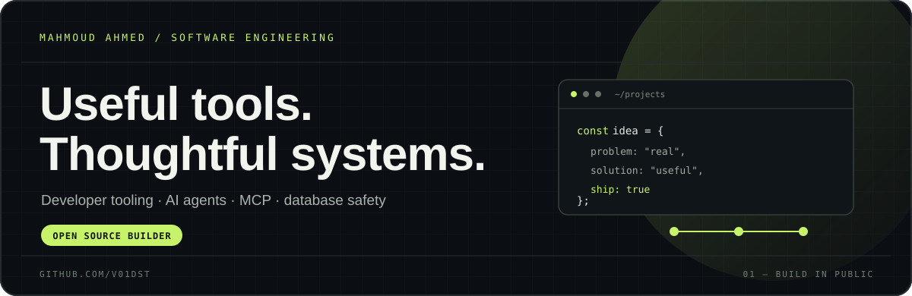

## About

I’m Mahmoud, a full-stack developer and product builder. I make practical software for people who build software: developer tools, AI agent systems, and focused utilities that solve real engineering problems.

My current interests are **AI agents, MCP, local-first software, and reliable developer workflows**.

## Featured work

| Project | What it does |
| --- | --- |
| [**AgentForge**](https://github.com/v01dst/agentforge) | A model-agnostic agent runtime and coding-agent platform with a terminal UI, extensible tools, and permission controls. |
| [**CtxSlim**](https://github.com/v01dst/ctxslim) | A local-first MCP proxy that reduces tool-catalog context while keeping existing servers in place. |
| [**DevDating**](https://github.com/v01dst/devdating) | Helps developers discover open-source projects and contribution issues that match their interests. |
| [**sql-guard**](https://github.com/v01dst/sql-guard) | Flags risky SQL migrations before they reach production. |
| [**sqlite-audit**](https://github.com/v01dst/sqlite-audit) | Read-only health, profiling, and integrity checks for SQLite databases. |
| [**paletteq**](https://github.com/v01dst/paletteq) | Deterministic color palette extraction from images, as a CLI and TypeScript library. |

[Explore all repositories →](https://github.com/v01dst?tab=repositories)

## Languages

 

## Tools I reach for

## How I work

- Start with a concrete problem and keep the first version focused.
- Prefer readable systems, clear output, and explicit controls.
- Make tools composable: useful in a terminal, a workflow, or a larger product.
- Ship, learn from real use, and keep improving.

## Contact

**Building useful things, one problem at a time.**

