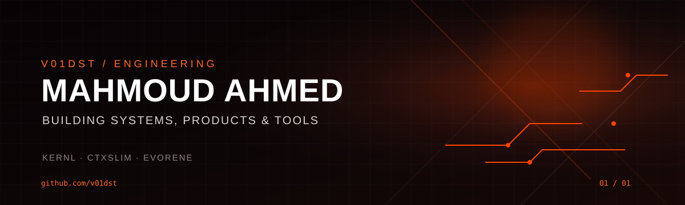

# MAHMOUD AHMED

### I build tools for people who build software.

**Developer tooling · AI agents · MCP · systems**

From agent runtimes and context tooling to safer database workflows, I like turning frustrating engineering problems into practical software.

[Projects](#selected-projects) · [LinkedIn](https://www.linkedin.com/in/mahmoud-ahmed-8a349842b/) · [Get in touch](#contact)

---

## What I care about

I’m a full-stack developer and product builder interested in the parts of software that make other software better: clear interfaces, dependable systems, useful automation, and tools that stay out of your way.

Lately, that has meant building around **AI agents and MCP**, while also making focused utilities for everyday engineering work.

## Selected projects

| Project | What it does |
| --- | --- |
| [**AgentForge**](https://github.com/v01dst/agentforge) | A model-agnostic agent runtime and coding-agent platform, with a terminal UI, extensible tools, and permission controls. |
| [**CtxSlim**](https://github.com/v01dst/ctxslim) | A local-first MCP proxy that reduces tool-catalog context while keeping your existing servers in place. |
| [**DevDating**](https://github.com/v01dst/devdating) | Helps developers find open-source projects and contribution issues that fit their interests and skills. |
| [**sql-guard**](https://github.com/v01dst/sql-guard) | Catches risky, potentially destructive SQL migrations before they reach production. |
| [**sqlite-audit**](https://github.com/v01dst/sqlite-audit) | Read-only health and integrity checks for SQLite databases. |
| [**paletteq**](https://github.com/v01dst/paletteq) | Deterministic color palette extraction from images, for the terminal or your own tools. |

More experiments and work in progress live in my [repositories](https://github.com/v01dst?tab=repositories).

## How I build

- **Solve a real annoyance.** Start with the problem and keep the first version focused.
- **Make behavior understandable.** Prefer clear output, explicit controls, and useful documentation.
- **Keep tools composable.** Build things that work from a terminal, in a workflow, or as part of a larger system.
- **Learn by shipping.** Publish, listen, improve.

## Toolbox

## Contact

---

**Building useful things, one problem at a time.**

