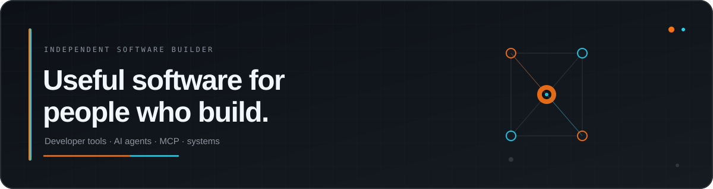

 

**I build useful tools for people who build software.**

*AI agents · developer tooling · MCP · systems*

---

## Now

- Shipping **AgentForge** — a model-agnostic agent runtime with a terminal UI, extensible tools, and permission controls.
- Maintaining **CtxSlim** and **mcp-forge** — tools that keep MCP context lean.
- Exploring local-first software and agent observability.

## What I build

My work sits where AI systems meet practical engineering: tools that make agents easier to extend, observe, and use in real workflows. I care about clear behavior, local-first data, and shipping things people can try.

## Featured

<table>
<tr>
<td width="50%" valign="top">

### AgentForge

A model-agnostic agent runtime and coding-agent platform. Terminal UI, extensible tools, workflows, permission controls.

</td>
<td width="50%" valign="top">

### AgentWatch

Local-first observability and deterministic benchmarking for coding agents. See what an agent did, measure with evidence.

</td>
</tr>
<tr>
<td width="50%" valign="top">

### CtxSlim

A local MCP proxy that cuts tool-catalog context by up to 72%. Zero config, zero API keys.

</td>
<td width="50%" valign="top">

### mcp-forge

Turn documentation URLs into lean, callable MCP tools. No more 1M-token context dumps.

</td>
</tr>
</table>

### More

[DevDating](https://github.com/v01dst/devdating) · discover projects and good first issues  
[sql-guard](https://github.com/v01dst/sql-guard) · catch risky SQL migrations  
[forgewatch](https://github.com/v01dst/forgewatch) · analyze project health locally  
[snapmark](https://github.com/v01dst/snapmark) · local-first knowledge vault  
[paletteq](https://github.com/v01dst/paletteq) · extract color palettes from images  
[whatport](https://github.com/v01dst/whatport) · offline port lookup

---

## Stack

 

---

## GitHub stats

 

---

## How I work

- Find the real friction; build the smallest tool that removes it.
- Make behavior clear, output useful, controls explicit.
- Keep projects composable, local-friendly, easy to try.
- Ship in the open, learn from use, improve.

**Building useful things, one problem at a time.**

